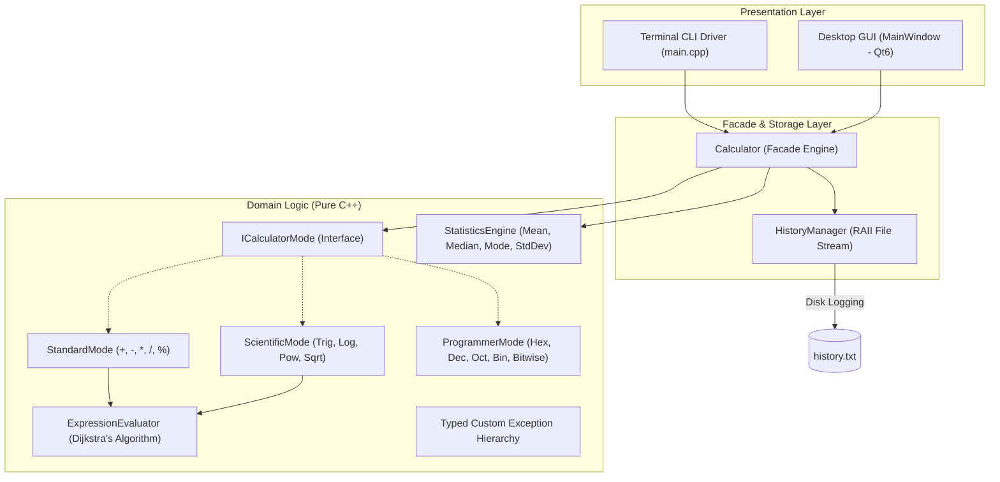

<div align="center">

# 🧮 Calculator Pro — Production C/C++ Suite

**An elite, modular, multi-mode desktop and terminal calculation suite engineered in Modern C++17 with Qt6.**

[](https://isocpp.org/)
[](https://www.qt.io/)
[](#-getting-started--compilation)
[](https://github.com/Guptha0)
[](LICENSE)

<br/>

<p align="center">
  <a href="#-architectural-overview">Architecture</a> •
  <a href="#-key-features">Features</a> •
  <a href="#-project-structure">Project Structure</a> •
  <a href="#-getting-started--compilation">Compilation</a> •
  <a href="#-internship-acknowledgement">Acknowledgement</a>
</p>

</div>

---

## 📌 Overview

**Calculator Pro** is an industrial-grade mathematical application developed as part of the **Auspify Technologies C/C++ Development Internship**. Designed from the ground up prioritizing **SOLID principles**, **clean separation of concerns**, and **zero memory leaks**, the project combines high-performance computational algorithms with modern presentation layers.

It bridges both worlds of software engineering:
1. **Interactive CLI Driver**: A resilient console calculator with stream error recovery (`std::cin.fail()`).
2. **Production Desktop GUI**: A hardware-accelerated Qt6 desktop application featuring responsive layouts, a dual-line history display, and global keyboard shortcuts.

---

## 🏛️ Architectural Overview

The project adheres to a strict **3-Tier Layered Architecture** powered by the **Facade** and **Strategy** design patterns:



- **Domain Isolation**: Core calculation logic contains zero GUI or console dependencies and is 100% unit-testable.
- **Dijkstra's Shunting-Yard Algorithm**: Implements infix-to-RPN (Reverse Polish Notation) parsing to ensure proper mathematical operator precedence ($2 + 3 \times 4 = 14$).
- **RAII File Persistence**: Execution records are automatically serialized with timestamps to `history.txt`.

---

## ✨ Key Features

| Icon | Feature | Description |
| :---: | :--- | :--- |
| 🧮 | **Standard Arithmetic** | Addition, Subtraction, Multiplication, Division, and Percentage operations with continuous calculations. |
| 🔬 | **Scientific Mode** | Trigonometric functions (`sin`, `cos`, `tan`), Logarithms (`log10`, `ln`), Exponentiation ($x^y$), Square Roots ($\sqrt{x}$), and constants ($\pi$, $e$). Configurable in Degrees or Radians. |
| 💻 | **Programmer Mode** | 64-bit integer calculations with live cross-radix conversions across **HEX**, **DEC**, **OCT**, and **BIN**, along with bitwise operations (`AND`, `OR`, `XOR`, `NOT`, `LSH`, `RSH`). |
| 📊 | **Statistical Analysis** | High-precision descriptive statistics: Mean ($\mu$), Median, Mode, Sample Variance ($s^2$ with Bessel's correction), and Standard Deviation ($\sigma$). |
| 🛡️ | **Robust Exception Tree** | Hierarchical error management (`DivisionByZeroException`, `InvalidDomainException`, `MalformedExpressionException`, `EmptyDatasetException`) preventing runtime crashes. |
| 📂 | **Persistent Session History** | Automatically appends expression logs and evaluation outputs to `history.txt` with sub-second timestamping. Past records reload into the GUI drawer on startup. |
| 🎨 | **Fluent Dark GUI** | Sleek UI styled with custom QSS, dual-screen live expression tracking, responsive button feedback, and full physical keyboard bindings. |

---

## 📂 Project Structure

```text
Calculator-Program/
├── CMakeLists.txt                  # Master CMake build configuration
├── main.cpp                        # Standalone console calculator driver
├── history.txt                     # Persistent calculation logs
├── resources/
│   ├── resources.qrc               # Qt Resource definition
│   └── styles/
│       └── dark_theme.qss          # Modern Fluent Dark UI styling
├── include/
│   ├── common/
│   │   └── Exceptions.hpp          # Custom C++ exception hierarchy
│   ├── engine/
│   │   ├── ICalculatorMode.hpp     # Base strategy interface
│   │   ├── Calculator.hpp          # Unified Facade orchestrator
│   │   ├── StandardMode.hpp        # Arithmetic computation module
│   │   ├── ScientificMode.hpp      # Trigonometric & transcendental math
│   │   ├── ProgrammerMode.hpp      # Radix conversion & bitwise manipulation
│   │   ├── ProgrammerEngine.hpp    # 64-bit bitmask logic
│   │   ├── StatisticsEngine.hpp    # Descriptive statistical analysis
│   │   ├── ExpressionEvaluator.hpp # Shunting-Yard parser & tokenizer
│   │   └── MemoryRegister.hpp      # Hardware register operations (MC, MR, M+, M-, MS)
│   ├── storage/
│   │   └── HistoryManager.hpp      # Persistent file stream manager
│   └── ui/
│       └── MainWindow.hpp          # Qt desktop window & event router
└── src/
    ├── main.cpp                    # Qt GUI entry point
    ├── engine/
    │   ├── Calculator.cpp
    │   ├── StandardMode.cpp
    │   ├── ScientificMode.cpp
    │   ├── ProgrammerMode.cpp
    │   ├── ProgrammerEngine.cpp
    │   ├── StatisticsEngine.cpp
    │   └── ExpressionEvaluator.cpp
    ├── storage/
    │   └── HistoryManager.cpp
    └── ui/
        └── MainWindow.cpp
```

---

## 🚀 Getting Started & Compilation

### Prerequisites

- **C++ Compiler**: GCC (`g++`) $\ge$ 9.0 or Clang $\ge$ 11.0 with C++17 support
- **Build System**: CMake $\ge$ 3.16
- **GUI Libraries** *(optional for GUI target)*: Qt6 (`qt6-base-dev`)

```bash
# On Debian / Ubuntu / WSL:
sudo apt update && sudo apt install -y build-essential cmake qt6-base-dev
```

---

### Option A: Build the Full Qt6 GUI Suite (Recommended)

```bash
# 1. Clone the repository
git clone https://github.com/Guptha0/Calculator-Program.git
cd Calculator-Program

# 2. Configure project via CMake
cmake -B build

# 3. Build executable
cmake --build build

# 4. Launch the application
./build/CalculatorGUI
```

---

### Option B: Build the Standalone Console CLI

If you want to run the terminal-based interactive calculator without Qt dependencies:

```bash
# Compile with g++
g++ -std=c++17 -Wall -Wextra main.cpp -o calculator.exe

# Run the console program
./calculator.exe
```

---

## 🖥️ Usage Showcase

### Terminal Interface
```text
===========================================
      Auspify C/C++ Calculator Program     
===========================================
Supported operations: + (Add), - (Sub), * (Mul), / (Div)

Enter operation (+, -, *, /) or 'q' to quit: +
Enter first number: 45.75
Enter second number: 14.25
-------------------------------------------
Result: 45.75 + 14.25 = 60
-------------------------------------------

Enter operation (+, -, *, /) or 'q' to quit: /
Enter first number: 100
Enter second number: 0
-------------------------------------------
[Runtime Error] Division by zero is undefined.
-------------------------------------------
```

### Persistent History Log (`history.txt`)
```text
[2026-11-02 21:38:00] [Standard] 45.75 + 14.25 = 60
[2026-11-02 21:38:12] [Scientific] sin(30) + sqrt(16) = 4.5
[2026-11-02 21:38:25] [Programmer] 0xFF & 0x0F = 15
```

---

## 🛡️ Error Handling Architecture

The application eliminates undefined behavior and runtime crashes through strict domain validation:

```cpp
try {
    double result = calc.calculate("sqrt(-25)");
} catch (const InvalidDomainException& e) {
    // Gracefully displayed on the GUI secondary display
    std::cerr << "[Domain Error]: " << e.what() << '\n';
} catch (const DivisionByZeroException& e) {
    std::cerr << "[Math Error]: " << e.what() << '\n';
} catch (const CalculatorException& e) {
    std::cerr << "[Calculation Error]: " << e.what() << '\n';
}
```

---

## 🎖️ Internship Acknowledgement

This project was engineered as part of **Task 1** for the **C/C++ Development Internship** at **Auspify Technologies**.

Special appreciation to the engineering mentors at **Auspify Technologies** for providing requirements and fostering industry best practices in software architecture, testability, and object-oriented design.

---

## 👨‍💻 Author

**Guptha**
- **GitHub**: [@Guptha0](https://github.com/Guptha0)
- **Role**: C/C++ Software Development Intern

---

<div align="center">
  <sub>Engineered with precision in C++17 & Qt6. Licensed under the MIT License.</sub>
</div>

